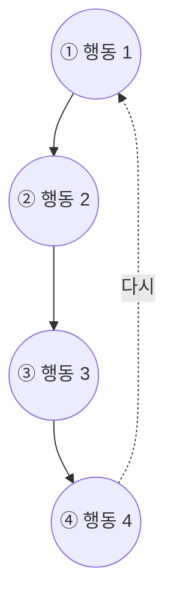

# 핵심 루프 (Core Loop)

> 출처: 단계 구성 · 두 루프의 구분 · 계기-행동-피드백 · New/More/Better/Emotional 네 관점 · 동기 점검 체크리스트는 스마일게이트 퓨처랩 「인프챌 툴킷」 2단계 [몰입 동기를 만드는 Core Loop 설계하기](https://page.onstove.com/devlog/kr/view/11119312?boardKey=142278&combined=false)를 바탕으로 했다. 이 스킬이 더한 것은 인터뷰 진행 방식, Core Fun과의 일관성 검사, 마디의 MECE 점검, 두 루프를 인게임 · 아웃게임 코어루프로 부르는 이름, 다이어그램을 Mermaid로 그리는 방법이다.

재미와 동기는 정답이 없다. 그래서 **사용자가 메인 기획자, Claude는 서브 기획자**다. 메인이 먼저 정하고, 서브는 그걸 받아 넓히고 걸리는 점을 짚는다. 다이어그램을 그리는 일과 앞뒤를 맞춰 보는 일은 서브가 맡는다.

| Claude가 한다 | Claude가 하지 않는다 |
|---|---|
| 열린 질문으로 묻기, 사용자 답을 그대로 기록하기, 그 답 위에 아이디어 덧붙이기, 걸리는 점 짚기, 사용자 답만으로 다이어그램 그리기, 체크리스트 · 일관성 검사 표 채우기 | 묻기 전에 후보부터 내기, 행동 · 계기 · 보상을 대신 정하기, 사용자의 답 고쳐 쓰기, 체크리스트 판정으로 "통과"를 선언하기 |

## 시작

1. **Core Fun 문장**을 받는다. core-fun 기록(문서 · 노션 페이지)이 있으면 그걸 읽고 문장 · 미학 · 메커닉 · 시그니처 제약 · 트레이드오프 · 반응 예측을 옆에 둔다. 문장이 없으면 core-fun 스킬을 먼저 권하고 멈춘다.
2. 기록을 어디에 남길지 한 번 묻는다 (노션 페이지 / 마크다운 파일). 기본값은 마크다운 파일 `YYYY-MM-DD-<게임>-핵심-루프.md`. core-fun 기록과 같은 곳에 두는 것을 권한다.
3. 툴킷 원문을 쓸 수 있으면 출처 링크를 기록 맨 위에 적는다.

## 진행 규칙 — 인터뷰 한 바퀴

core-fun과 같다. 단계마다 이 순서로 돈다.

1. **묻는다.** 후보 없이 열린 질문 하나. 많아도 둘.
2. **사용자가 답한다.** 한 말 그대로 기록한다. 모호한 말은 장면으로 되묻는다 ("보상을 느낀다" → "어느 순간, 화면에 무엇이 보일 때 보상을 느끼나요?").
3. **서브 기획자로 덧붙인다.** 사용자의 답 위에서만, 많아도 세 개. 각 한 줄 + 이유 한 줄.
   - **키우기** — 그 답을 더 밀어붙이면 생기는 것
   - **비틀기** — 같은 동기를 다른 방법으로 만드는 안
   - **걸리는 점** — Core Fun과 부딪히거나, 루프가 끊기거나, 플레이에서 문제가 될 곳
4. **사용자가 정한다.** 덧붙인 것마다 받기 · 고쳐 받기 · 버리기 · 보류. 다음 단계로 가자고 할 때 넘어간다.

지키는 것:

- **막혔을 때만 후보.** "모르겠다", "예시 줘", "후보 줘"라고 할 때만 후보 2~3개를 내고, 하나를 권하며 이유를 한 줄 붙인다. "알아서 해"면 권한 안으로 가되 기록에 **(Claude 제안, 사용자 미검토)**로 표시한다.
- **출처를 남긴다.** 정해진 것마다 `[내 안]` · `[Claude 제안 받음]` · `[Claude 제안 고쳐 받음]` 중 하나를 붙인다.
- **사용자의 답을 고쳐 쓰지 않는다.** Claude가 다듬은 문장은 `[정리]`로 표시하고 원문 옆에 둔다.
- **제안은 장면으로 쓴다.** "A를 B로 본다" 같은 추상어 대신, 누가 · 언제 · 화면에서 무슨 일이 일어나는지를 한 문장으로 적는다. 사용자가 "무슨 말이냐"고 되물으면 같은 말을 되풀이하지 말고 예시 하나로 바꿔 말한다.
- **`[정리]`에 새 말을 만들지 않는다.** 사용자가 쓰지 않은 별명 · 줄임말 · 지어낸 혼잣말을 붙이면 사용자가 자기 기록을 못 알아본다. 사용자가 쓴 낱말로만 줄인다.
- **앞 단계를 고치면 뒤 단계 검사를 다시 한다.**
- **Core Fun을 기준으로 삼는다.** 루프가 Core Fun 문장에 없는 재미를 중심에 두게 되면 걸리는 점으로 짚는다. Core Fun을 바꿀지는 사용자가 정한다.

## 5단계

### 1단계 — 핵심 행동 뽑기 (인게임 코어루프의 마디)

묻는다: "Core Fun 문장 속에서 플레이어가 **초~분 단위로** 반복하는 행동은?" **명사형 동사 4개**로 받는다 (예: 재료 획득 · 실험 및 조합 · 결과 확인 · 주문에 도전). 이 네 개가 끝까지 다이어그램의 마디이고 Core Loop의 큰 뼈대다 — 인터뷰가 길어져 세부 행동이 늘어도 마디를 늘리지 않고, 마디 안의 선택지로 적는다.

- **마디는 사용자가 정한다.** 네 개로 안 나뉘거나 넘치면 Claude가 묶거나 쪼개지 않고 사용자에게 되묻는다.
- **가급적 MECE로 나눈다** (Mutually Exclusive, Collectively Exhaustive — 서로 겹치지 않고, 모으면 빠짐이 없게). 범위는 **한 판**이다 — 네 마디만 읽어도 한 판이 처음부터 끝까지 어떻게 진행되는지 요약해 볼 수 있어야 한다.

덧붙일 때 짚을 것:

- Core Fun 문장에 있는데 목록에서 빠진 행동
- 목록에 있는데 Core Fun 문장 어디에도 없는 행동 — 빼거나, Core Fun을 넓힐지 사용자가 정한다
- core-fun의 **시그니처 제약 · 트레이드오프가 어느 행동에서 일어나는지** 안 보이는 경우
- 머릿속에서만 일어나는 행동("구상한다", "계산한다") — 마디가 되려면 화면에서 보이는 행동이어야 한다
- **겹침** — 두 마디가 같은 때의 같은 행동을 가리킨다. 자르는 기준이 둘 이상 섞였는지 본다 (예: 자원의 흐름으로 자른 마디와 차례로 자른 마디가 함께 있다)
- **빠짐** — 게임에서 실제로 하는 행동인데 어느 마디에도 들어가지 않는다

### 2단계 — 인게임 코어루프 · 아웃게임 코어루프 나누기

코어루프는 둘로 나눠서 진행한다. **인게임 코어루프**는 한 판 안에서 도는 고리, **아웃게임 코어루프**는 판 바깥에서 도는 고리다 (툴킷의 Gameplay Loop · Progression Loop). MECE도 범위를 나눠서 본다 — 인게임은 한 판 안의 행동만, 아웃게임은 판 바깥의 행동만.

먼저 두 루프의 차이를 보여 준다.

| 항목 | 인게임 코어루프 | 아웃게임 코어루프 |
|---|---|---|
| 범위 | 한 판 안 | 판 바깥 (판이 끝난 뒤부터 다음 판을 시작하기 전까지) |
| 단위 시간 | 짧다 (초~분) | 길다 (수십 분~수 시간) |
| 목표 | 반복적 몰입 | 장기적 성장 · 진행 |
| 감정 | 즉시 반응과 쾌감 | 성취, 전략 변화, 진척 |
| 유형 | 조작, 전투, 미니게임 | 스킬 트리, 챕터, 해금 |

묻는다:

- "1단계 행동이 한 바퀴 도는 **순서**는? 마지막 행동 뒤에 어느 행동으로 돌아가나요?" → 인게임 코어루프
- "한 판이 끝난 뒤 **다음 판을 시작하기 전까지** 플레이어가 반복하는 행동은? 그 사이에 무엇이 쌓이고 바뀌나요?" → 아웃게임 코어루프. 1단계와 같은 규칙으로 **명사형 동사 3~4개**를 받는다 (마디는 사용자가 정한다 · 가급적 MECE · 범위는 판 바깥). 뼈대 4개는 인게임의 기준이고, 아웃게임은 단순하면 3개로 줄여도 된다.

덧붙일 때 짚을 것:

- 두 루프가 **어디서 이어지는지** (아웃게임이 인게임의 무엇을 바꾸나 — 새 선택지? 수치?)
- 아웃게임이 힘(수치)만 올리면 인게임의 판단이 의미를 잃는 곳 — 진 이유가 "덜 키워서"가 된다
- 테스트 빌드 분량 안에서 아웃게임 코어루프가 **한 번이라도 보이는지**

### 3단계 — 계기 → 행동 → 피드백 잇기

두 고리의 마디마다 묻는다: "플레이어는 왜 **[이전 행동]을 끝내고 기꺼이 [이 행동]으로** 넘어가고 싶어 하나요? 이 행동을 하면 화면에 무엇이 보이나요?"

```
[행동 이름]
> 계기(Trigger)  : 이 행동을 시작하게 만드는 동기 · 자극
> 행동(Action)   : 플레이어가 하는 것
> 피드백(Feedback): 시스템이 즉시 보여 주는 반응 · 결과
```

사용자가 계기 · 피드백을 떠올리기 어려워하면, 후보 대신 **네 관점을 거울로** 보여 준다 (툴킷 원문).

| 관점 | 묻는 것 |
|---|---|
| New (새로운 경험) | 이 행동으로 이전에 없던 요소를 얻는가? |
| More (양적 증가) | 기존 자원의 양이 늘어나는가? |
| Better (질적 향상) | 기존 요소의 성능이 나아지는가? |
| Emotional (심리적 보상) | 성취감 · 숙달감 같은 마음의 보상이 있는가? |

덧붙일 때 짚을 것:

- 피드백이 **다음 행동의 계기가 되지 않는** 곳 — 루프가 끊긴다
- 피드백이 숫자 변화뿐이라 **보이지 않는** 곳 (core-fun에서 감각을 골랐다면 특히)
- core-fun 4단계 반응 예측(혼잣말)이 어느 피드백에서 나오는지 이어지지 않는 곳

### 4단계 — Core Loop 다이어그램

툴킷의 Core Loop 다이어그램 양식을 그대로 쓴다: **마디 4개가 한 줄로 도는 고리**, 마디마다 **계기(Trigger) · 보상(Feedback)** 한 칸씩. 이 그림은 사람이 읽는 기획서에 들어간다 — 10초 안에 읽혀야 한다.

- 그림(Mermaid)에는 **마디 이름만** 넣는다. 원 4개를 세로로 잇고, 마지막 마디에서 첫 마디로 돌아가는 점선 하나.
- 계기 · 보상은 그림 바로 아래 **표**에 마디와 같은 순서로 적는다. 칸마다 한두 문장.
- **그림에 넣지 않는 것**: 갈래 · 조건 · 예외 · 차례별 세부 행동 · 화살표마다의 설명. 그것은 구현용 상세 흐름도이고, 시스템 기획서나 기술 아키텍처 문서의 몫이다. 인터뷰에서 나온 세부 규칙은 그림이 아니라 규칙 표에 글로 적는다.
- 마디는 1단계에서 사용자가 정한 네 개 그대로다. Claude가 고르거나 묶거나 순서를 바꾸지 않는다. 세부 행동은 마디 안의 선택지로 표에 적는다.
- 그리기 전에 **MECE 점검**을 표로 보여 준다. 인터뷰에서 나온 행동을 모두 적고 어느 마디에 들어가는지 잇는다. 인게임 점검에는 한 판 안의 행동만, 아웃게임 점검에는 판 바깥의 행동만 적는다. 두 마디에 걸치는 행동(겹침)과 어느 마디에도 없는 행동(빠짐)을 표시한다. 고칠지는 사용자가 정한다.
- 고리는 둘이다 — **인게임 코어루프**와 **아웃게임 코어루프**. 한 그림에 섞지 않고, 같은 양식(고리 그림 + 계기 · 보상 표 + MECE 점검 표)으로 하나씩 따로 그린다.
- **기록에 있는 말만으로** 그리고, 마디 이름은 사용자가 쓴 낱말로 붙인다.



| 마디 | 계기 (Trigger) | 보상 (Feedback) |
|---|---|---|
| ① 행동 1 | 왜 이 행동을 시작하나 | 하면 무엇이 보이고 무엇을 얻나 |
| ② 행동 2 | | |
| ③ 행동 3 | | |
| ④ 행동 4 | | |

빈 칸(계기 · 보상이 아직 없는 곳)은 `?`로 남기고 사용자에게 보여 준다. 사용자가 고치면 다시 그린다. 툴킷이 요구하는 결과물은 **팀원과 합의된 다이어그램**이므로, 사용자가 "이게 맞다"고 할 때 확정한다.

### 5단계 — 동기 점검 체크리스트

아래 세 줄을 기록에 있는 말만 근거로 판정해 보여 준다. **판정은 제안일 뿐, YES로 체크하는 것은 사용자다.**

| 체크 (툴킷 원문) | 근거가 되는 기록 | 판정 |
|---|---|---|
| Loop의 각 단계에서 "다음 행동으로 넘어갈 동기"가 충분히 주어지는가? | 3단계 계기 · 피드백 | ✅ / ⚠️ (끊기는 마디) / ❌ |
| 한 바퀴 돌았을 때 즉각적이거나 누적적인 보상을 느끼는가? | 3단계 피드백, 2단계 아웃게임 코어루프 | |
| 반복될수록 경험(도전감 · 보상 · 흥미)이 점진적으로 변하거나 진화하는가? | 2단계 아웃게임 코어루프, 웨이브 · 난도 변화 | |

⚠️ · ❌ 이 있으면 어느 단계로 돌아가 고칠지 사용자가 정한다. 세 줄 모두 사용자가 YES로 체크하면 끝.

## 일관성 검사 — Core Fun과 맞나

5단계 직후 아래 표를 채워 보여 준다. 고칠지는 사용자가 정한다.

| Core Fun의 것 | 루프의 어느 마디 · 피드백에서 일어나나 | 판정 |
|---|---|---|
| 시그니처 제약 1 · 2 · 3 | | ✅ 마디 있음 / ⚠️ 흐림 / ❌ 없음 |
| 핵심 트레이드오프 (선택 A vs B) | | |
| 고른 미학 | | |
| 반응 예측 (혼잣말) | | |

자주 나오는 어긋남:

- 트레이드오프는 있는데, 그 선택을 하는 마디가 루프에 없다
- 아웃게임 코어루프가 힘을 올려서 Core Fun의 "다른 선택을 했으면" 아쉬움을 "더 키웠으면"으로 바꾼다
- 감각 미학을 골랐는데 피드백이 숫자뿐이다

## 기록 틀

```markdown
# <게임> — 핵심 루프 (YYYY-MM-DD)

> 방법론: 인프챌 툴킷 2단계 (링크)
> 출발점 Core Fun 문장: ...

## 문서 히스토리
| 날짜 | 변경 내용 |
|---|---|
| YYYY-MM-DD | 최초 작성 — 인터뷰 (메인: 사용자, 서브: Claude) |

## 1. 핵심 행동
- 행동 1: ... [내 안]

## 2. 인게임 코어루프 · 아웃게임 코어루프
- 인게임 코어루프: 행동 1 → 행동 2 → 행동 3 → 행동 4 → 행동 1
- 아웃게임 코어루프: 행동 1 → 행동 2 → 행동 3 (→ 행동 4) → 다음 판
- 이어지는 곳: ...

## 3. 계기 → 행동 → 피드백
(행동마다 세 줄)

## 4. Core Loop 다이어그램
(인게임 · 아웃게임 각각: 마디 4개(아웃게임은 3~4개)의 고리 그림 + 마디별 계기 · 보상 표 + MECE 점검 표)

## 5. 동기 점검 체크리스트
(표 — 사용자 체크)

## 일관성 검사 (Core Fun과)
(표)

## 서브 기획자 제안 기록
| 단계 | 종류 | 제안 | 결정 |
|---|---|---|---|

## 정할 것
| 정할 것 | 기본값 | 언제 정하나 |
|---|---|---|
```

**결론과 기록을 나눈다.** 인터뷰가 길어지면 한 문서가 읽을 수 없게 길어진다. 인터뷰를 마치면 사람이 읽는 **결론 문서**(규칙 · 다이어그램 · 점검)만 짧게 남기고, 사용자 원문과 제안 기록은 **기록 문서**로 떼어 링크한다. 「정할 것」은 여러 문서에 흩지 말고 한 곳에만 두고 나머지 문서는 그곳으로 링크한다.

## 끝내기

- 사용자가 다이어그램을 확정하고 체크리스트 세 줄을 YES로 체크하면 끝. 정할 것 · 미검토 기본값을 기록에 남긴다.
- 기록을 다시 열어 다이어그램이 그림으로 보이는지 확인한다 (노션 · 마크다운 뷰어에서 Mermaid가 렌더되는지). 못 봤으면 못 봤다고 말한다.
- 다음 단계를 한 줄로 알린다: 툴킷 3단계 플레이 테스트 설계 — 검증할 가설은 core-fun 4단계 반응 예측과, 이 체크리스트에서 ⚠️ 였던 곳에서 뽑는다.
